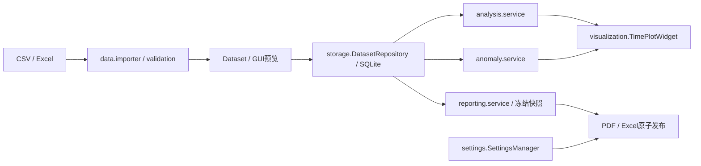

# V1.0 软件设计说明书

软件：智电析电力系统运行数据分析与可视化软件 V1.0，版本1.0.0。本文对应真实smartpower代码，不声明未实现的三相、谐波或能量功能。

## 1 概述与目标

面向Windows64位离线运行，管理非负单相交流有效值采样，复用V0.1～V0.9模块，形成可验证的目录分发与安装候选包。优先数据一致性、清晰来源与错误保护。

## 2 环境与总体架构

Python3.13、PySide6、Pandas、NumPy、PyQtGraph、SQLite、openpyxl、ReportLab；PyInstaller构建onedir，Inno Setup制作当前用户安装器。入口main.py调用smartpower.application.main；create_application设置身份、版本、中文翻译、浅色主题和原创图标。MainWindow用QStackedWidget与PAGE_SPECS构造八页。

## 3 模块划分与数据流

- data：Dataset、import_file、validate_frame、generate_demo、export_demo、query_rows。文件解析、字段校验和演示来源与GUI分离。
- storage：DatasetRepository提供save/list_datasets/load/delete，StorageError继承数据错误语义。
- analysis：voltage/current/power_factor/statistics/power/service。只处理数组和数据对象，不访问Qt控件。
- anomaly：Thresholds、AnomalyEvent、DetectionResult、detect_anomalies，保存原始行索引和来源。
- visualization：prepare_samples、SampleTimeAxis、TimePlotWidget、save_png；绘图代表点不进入完整统计输入。
- reporting：build_report_snapshot、ReportSnapshot、export_pdf、export_excel、atomic_report、字体与矢量图表。
- settings：AppSettings校验及SettingsManager版本化JSON持久化。
- ui：八页、表格模型、TaskThread和公共组件；后台结果由主线程回调更新。
- resources：按模块__file__解析assets，不依赖当前工作目录；冻结包资源只读。
- release_check：显式命令行隔离验证，不读取任意脚本、不自动运行；目录必须新建，重开需本工具标记。

## 4 SQLite设计

app_metadata(key主键,value)记录schema_version=2。datasets包含id、name、imported_at、simulated、row_count；samples包含dataset_id外键、position、sampled_at、voltage、current、power_factor，主键(dataset_id,position)，删除级联。SQLite约束保护非负值与PF范围；仓库校验在写入前执行。V1.0不改变表结构。

保存以事务写入数据集及全部记录，失败回滚。load在读取事务中核对元数据数量与采样行，按position恢复原始顺序。未知高版本数据库拒绝修改。连接在上下文finally关闭。

## 5 导入与校验

CSV使用Pandas并尝试UTF-8-sig/GB18030；Excel用openpyxl引擎读取第一表。检查空文件、唯一表头、必需四字段、时间合法性、缺失值、实数有限非负U/I与0≤PF≤1。时间不接受模糊数值序号/时区。错误汇总有数量限制，避免大量非法行撑爆消息框。模拟来源标记保守保留；普通文件仅为来源未核验。

## 6 电气统计

Statistics返回quantity/unit/count/mean/maximum/minimum/population_std。numeric_samples拒绝空序列、错误维度、文本/布尔/复数、负数、NaN/Infinity。总体标准差ddof=0；先减最小值，再按极差归一化计算，常量序列标准差为0，避免相邻大浮点差值丢失与平方溢出。

## 7 单相功率

S=U×I；P=S×PF；|Q|=S×sqrt(max(0,(1−PF)(1+PF)))。单位VA/W/var；每点长度须一致，不广播。拒绝非有限/不可表示结果及正值下溢成零。数组只读，统计沿用统一模块。PF平均为采样算术平均，不是时间段综合PF。

## 8 时间序列与异常检测

prepare_samples稳定排序时间用于显示，保留原始索引、重复时间及指纹。时间按整数秒与纳秒余量映射，避免跨日期溢出。PyQtGraph在显示层抽稀；异常基于完整校验数据，严格U<下限/U>上限/I>上限。DetectionResult分别给出事件数与唯一异常采样点数。同一点多事件不合并遗漏，切换配置通过revision与指纹拒绝旧结果联动。

## 9 报告流程

报告页启动前固定数据集、标题、阈值和字体。build_report_snapshot只读一次仓库，复用分析/检测服务，bytes背书冻结缓冲区，避免后续修改。报告不会修改数据库。

PDF含元数据、统计、三类矢量图、检测状态/阈值、全部事件和限制。DeferredEventTable按最多256条延迟构造Paragraph/LongTable；分批跨页重复表头，所有事件仍按原顺序输出。字体覆盖按不同字符集合验证，不建立完整巨型字符串。当前未实现安全取消或百分比进度，仅显示忙碌状态与容量说明。

Excel以openpyxl write_only写六表，完整原始顺序和精确时间文本保留，逐单元格字符串禁用公式解释。提前检查行上限，文件和工作簿句柄finally关闭。

atomic_report与CSV/PNG在同目录创建临时文件，成功后才发布；默认不覆盖，确认后os.replace。独占发布处理同名竞态；失败清理自身临时文件，保留原目标。强杀可能残留未发布临时文件，不扫描删除用户文件。

## 10 设置和用户目录

QStandardPaths按稳定组织名/正式软件名确定用户SQLite与JSON位置，独立于安装目录/当前目录；测试可显式覆盖隔离路径。SettingsManager读取版本化JSON并校验目录/字体/启动页，损坏或无权限时附警告回退，保存前保留旧文件；保存采用flush/fsync和原子替换。

## 11 线程、状态与错误

TaskThread只执行纯操作并保存result/error，控件只在主线程更新。页面busy时禁用敏感操作，MainWindow关闭事件等待后台完成。revision、数据集身份和指纹阻止延迟结果冒充新结果；失败清除易误读的旧分析。异常用中文上下文提示，不吞掉失败，不输出虚构数值。

## 12 冻结构建与安装

.spec使用相对源码根、明示assets与许可目录，收集实际Qt/数值/报告依赖，不收数据库或报告。onedir动态库便于检查和替换。构建清理DLL搜索PATH，拒绝从开发工具目录收集原生库，避免Poppler/ICU等同名DLL污染；VC运行库统一使用锁定PySide6轮子携带的版本。窗口显示调度到已启动的Qt事件循环，避免极早关闭先于退出事件处理。EXE为windowed、asInvoker、1.0.0版本资源，清单声明高DPI/longPathAware但不承诺所有路径支持。

Inno Setup仅当前用户，支持专用目录选择、开始菜单、可选桌面图标和卸载；无开机项、服务、自动联网或UninstallDelete用户目录规则。实际运行/安装验收与未测范围见TEST_REPORT_V1.0.md。

## 13 适用限制与发布边界

不提供设备安全认证、能耗积分、三相或谐波。普通长路径、跨机默认中文字体、超大完整PDF、强杀/断电耐久性和Windows10存在限制。独立干净机、签名、全面漏洞与LGPL对应源码/重链接权利等发行审查未完成时，保持候选状态，不自动发布或登记软著。
