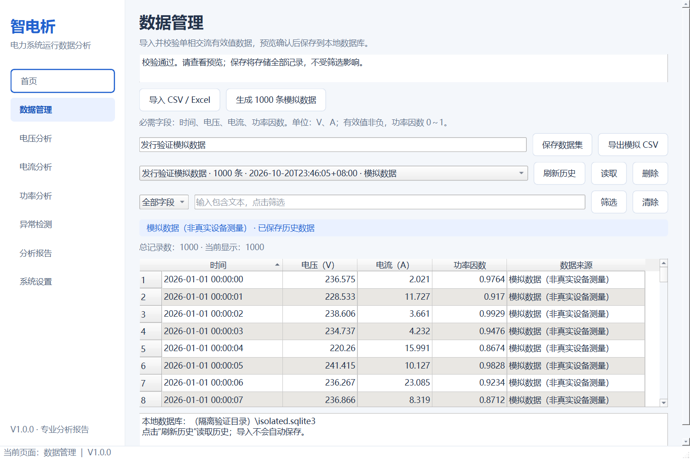
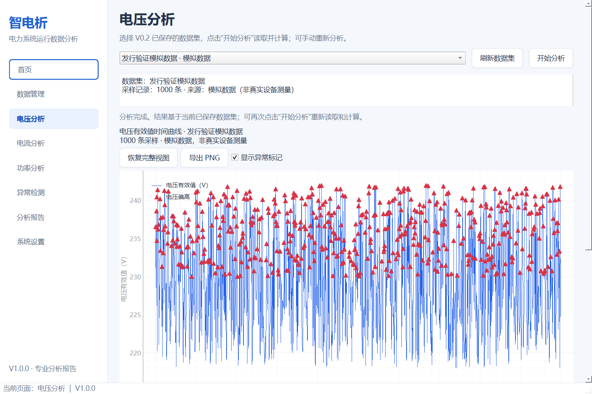
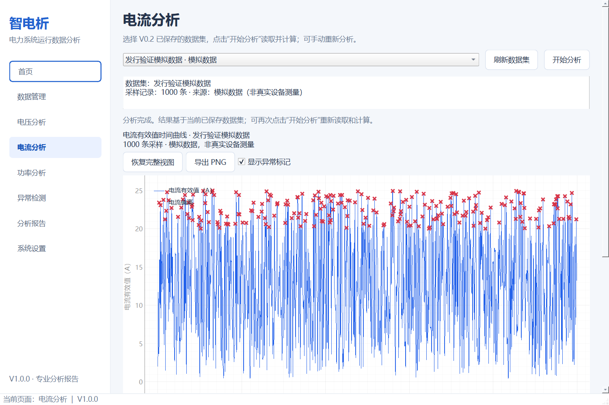
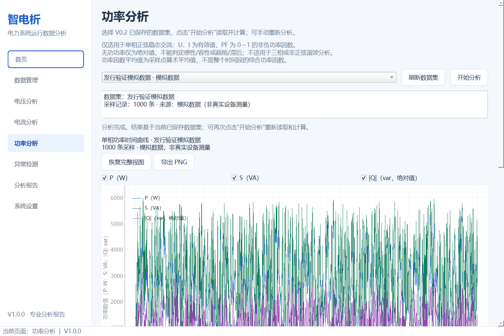
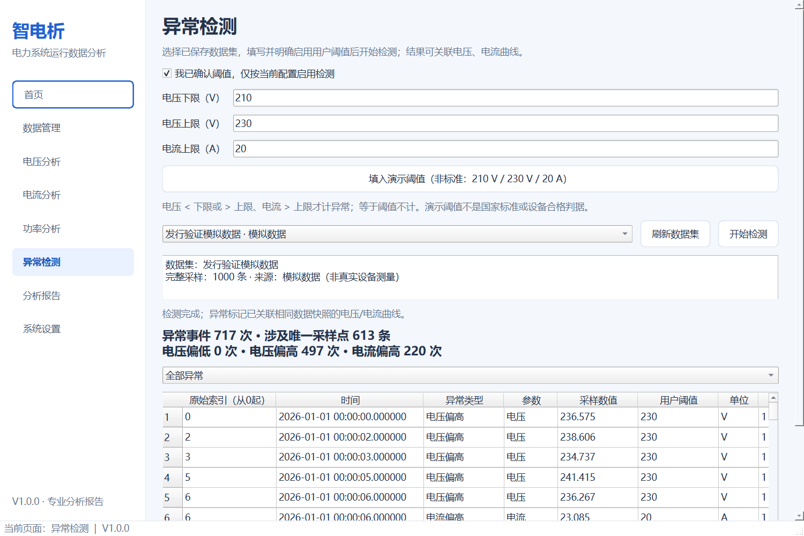
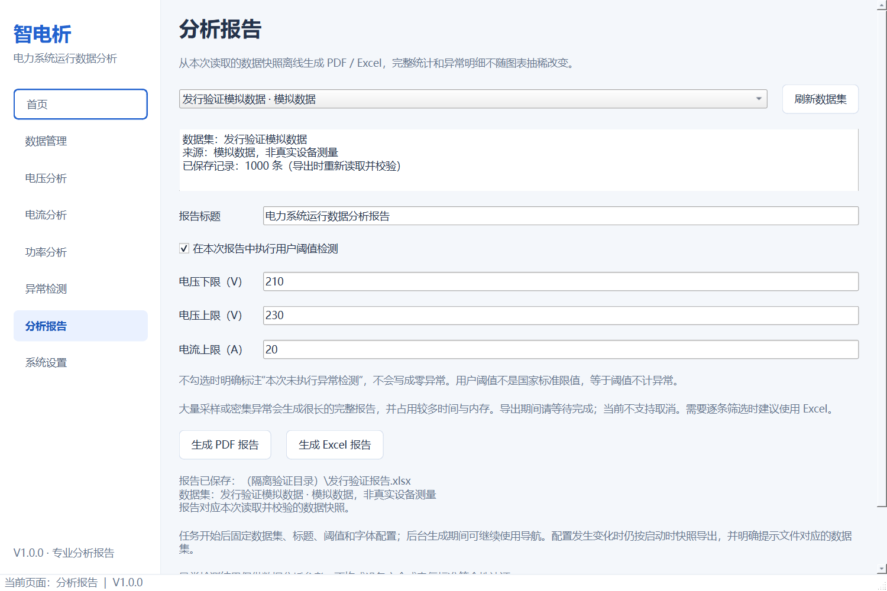
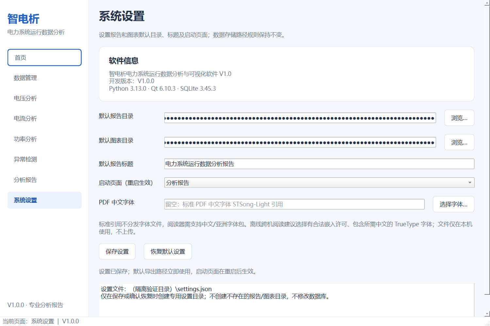

# 智电析电力系统运行数据分析与可视化软件 V1.0 用户操作手册

软件版本：1.0.0。交付状态：发行候选版本，最终验收状态见 TEST_REPORT_V1.0.md；安装包未签名，不自动发布正式 Release。

## 1 软件介绍

本软件离线管理单相交流采样数据，提供统计、曲线、用户阈值检测与报告。演示数据明确标为“模拟数据，非真实设备测量”，不得用于冒充实测结论。

## 2 适用范围

仅适用于单相正弦稳态模型。电压U、电流I为非负有效值，PF为0～1非负功率因数；不是瞬时波形、三相、谐波、能耗积分或保护装置。检测结果不构成安全或国家标准符合性认证。

## 3 运行环境

目标Windows11 64位。完整onedir分发目录自带Python与依赖，无需另外安装Python。Windows10、不同电脑和实际系统DPI切换的验证范围见测试报告；不得据本机结果推断所有电脑兼容。

## 4 安装

从审核通过的来源取得SmartPowerAnalyzer-Setup-1.0.0.exe，并核对SHA256SUMS.txt。安装器默认为当前用户安装，不申请管理员权限。选择专用、较短的安装目录；默认在当前用户LocalAppData的Programs目录。可选择桌面快捷方式，开始菜单提供启动和卸载入口。不要将程序直接安装进个人报告或数据库目录。

便携版必须完整解压SmartPowerAnalyzer-Portable-1.0.0.zip，保留_internal和所有依赖，不能只复制一个EXE。便携版同样将用户数据保存在用户目录，不将数据库放在程序旁边。

## 5 启动

从开始菜单、桌面快捷方式（如已选择）或完整分发目录中的SmartPowerAnalyzer.exe启动。首次进入首页；系统设置可更改下次启动页面。核心业务不需要联网，不包含自动更新、后台服务或开机启动项。

## 6 界面

左侧八个页面依次为首页、数据管理、电压分析、电流分析、功率分析、异常检测、分析报告、系统设置。窗口可最小化、最大化和缩放，最小900×620，长内容可滚动。

本手册截图来自真实冻结EXE、隔离模拟数据；绝对路径已在实际控件中遮蔽，未制作虚构界面或分析数值。

## 7 数据导入

进入数据管理，点击导入选择.csv或.xlsx。CSV支持UTF-8与GB18030，Excel读取第一个工作表。中文路径可用；普通超长路径受系统策略、外部库和安装工具限制，建议使用短路径。读取在后台进行，先预览，确认后保存。

## 8 数据格式

第一行为唯一表头，至少包含下列四列：

| 时间 | 电压 | 电流 | 功率因数 |
|---|---|---|---|
| 2026-01-01 00:00:00 | 220 | 10 | 0.9 |

以上一行仅为格式示例。电压单位V、电流A、PF无量纲。时间使用本地无时区日历日期时间，避免Excel数字序号、模糊日期或带时区文本。空文件、重复/缺失字段、无效时间、缺失/非法/负数数值、NaN、Infinity和PF越界会明确拒绝。额外字段不参与本版电气计算，按导入提示处理。

## 9 预览与保存

预览表支持滚动、列排序、基本筛选和总数显示；这些操作不改变原始保存顺序。填写数据集名称再保存全部记录。历史列表可刷新、读取或确认删除指定数据集。未保存预览在替换/关闭时需确认；数据库失败时保留预览以便重试。

## 10 电压分析

刷新已保存数据集，选择后点击“开始分析”。显示数据集、来源、数量、平均/最大/最小电压及总体标准差，单位V。没有选择或计算失败时不会沿用旧结果。

## 11 电流分析

操作同电压分析，单位A。最大电流为采样电流有效值最大值，不是交流瞬时峰值。总体标准差采用ddof=0。

## 12 功率分析

每点计算S=U×I（VA），P=S×PF（W），|Q|=S×sqrt(max(0,(1−PF)(1+PF)))（var）。|Q|仅为无功绝对值，不能判断感性/容性或超前/滞后。PF平均值为采样点算术平均，不是时间段综合功率因数。超出float64表示范围的结果明确拒绝，包括非零结果下溢为零。

## 13 曲线交互

曲线按时间稳定排序显示，重复时间保留。不等间隔按实际时间绘制。鼠标滚轮缩放、左键平移，“恢复完整视图”重置范围；悬停查看采样值。功率图可切换P、S、|Q|。显示抽稀不影响完整统计、检测或Excel原始数据。

## 14 异常检测

选择数据集、填写阈值、明确勾选启用，再点击“开始检测”。电压低于下限/高于上限、电流高于上限触发；等于阈值不计异常。同一点可有多个事件，界面分别统计事件数与唯一异常采样点数。原始索引从0开始。

## 15 阈值设置

电压下限小于上限，电流上限大于0，均为有限非负值。“演示阈值”只是填写示例，仍需启用检测，不代表国家标准。修改数据集、阈值或启用状态会清除旧结果和旧图表标记；需重新检测。密集图表标记仅减少显示量，明细保持完整。

## 16 PNG导出

分析完成后在曲线区域选择“导出PNG”，选择路径并确认覆盖（如目标已存在）。导出当前图表与来源标记；切换数据集后旧图不能当作新数据导出。PNG属于显示图，不替代完整采样数据。

## 17 PDF报告

在分析报告选择已保存数据集，核对名称/来源/数量，可按本次报告明确启用阈值。选择生成PDF并指定路径。导出期间固定本次快照；修改界面选择不会混用数据。后台忙碌时等待完成再关闭，不得通过任务管理器强杀来“取消”。当前没有安全取消功能，进度条表示正在执行，不提供百分比估算。

PDF含封面、统计与三类曲线、检测状态、阈值、全部异常明细及说明。V1.0按每批最多256事件延迟排版，仍不截断异常。大量事件会生成非常多页面，需预留时间和内存；逐条筛选建议Excel。

默认PDF采用STSong-Light引用，不嵌入字体；接收方阅读器须支持中文/亚洲字体。跨机分发建议在设置中选择有合法嵌入许可、包含报告所需字符的TrueType字体。缺失/缺字字体会报错，不能保证所有阅读器显示一致。

## 18 Excel报告

报告包含报告概况、电压分析、电流分析、功率分析、异常检测、原始数据六个工作表；保留完整原始顺序与来源。日期列为Excel日期，同时保留精确时间文本。超过Excel工作表容量会拒绝，不静默截断。字符串按文本保存以防公式注入。不要将图表代表点当作全部记录。

## 19 系统设置与关于

设置默认报告/图表目录、报告标题、启动页面、可选PDF TrueType字体，点击保存。软件信息显示正式名称、版本、Python/Qt/SQLite。选择已存在的导出目录，软件不创建拼错的报告目录。恢复默认需要确认，不修改数据库。配置损坏或读取失败会提示，保存前保留旧文件。

## 20 备份

先退出软件，复制用户数据目录中的datasets.sqlite3和settings.json，并独立备份导出的PDF、Excel、CSV和PNG。默认在当前用户应用数据目录下的SmartPowerAnalyzer/软件正式名称目录；系统设置会显示实际配置位置。在本机Qt默认配置中数据库与设置均位于这一用户应用目录。不要复制正在写入的数据库，不直接编辑SQLite表。用于自动验证的SMARTPOWER_DB_PATH/SMARTPOWER_SETTINGS_PATH是隔离测试入口，普通用户不需要设置。

## 21 常见错误

- 缺字段/非法值：根据错误中的列和行修正源文件，重新导入，不要填充虚构测量值。
- 文件被占用/无权限：关闭占用程序或选择可写目录，原目标文件不替换。
- PDF缺字：选用合法且覆盖所需字符的TrueType字体；不是任意.ttf都支持中文。
- 普通超长路径失败：改用更短目录。扩展路径和longPathAware声明不等于所有工具无条件支持。
- 后台任务尚未完成：等待结束，不能用关闭窗口强制中断。
- EXE缺少组件：重新完整解压并核对校验值，不要从不明网站下载替换DLL。

## 22 卸载与重新安装

从开始菜单卸载入口或Windows应用设置卸载。卸载移除安装器拥有的程序文件和快捷方式，不删除用户数据库、配置或报告。先自行备份，再操作。重新安装后同一用户的数据目录仍可读取；最终实测范围见测试报告。便携目录可在退出后移除，用户应用数据仍保留；本软件不代替用户清理个人目录。

## 23 已知限制

尚未完成独立无Python机器、Windows10、真实系统DPI切换、多机器阅读器、数字签名和完整发行法律审查。PyPI公告查询不覆盖所有Qt原生组件、Windows和CPython漏洞。软件不推断数据可信度或设备安全。正式对外发布需完成RELEASE_READINESS.md中的阻塞项并经用户审核。
